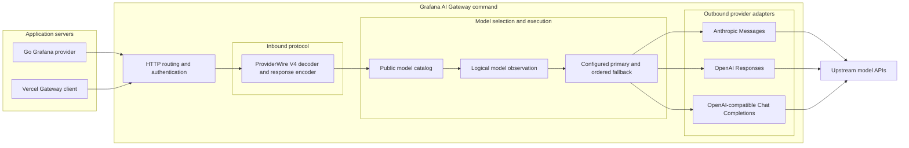
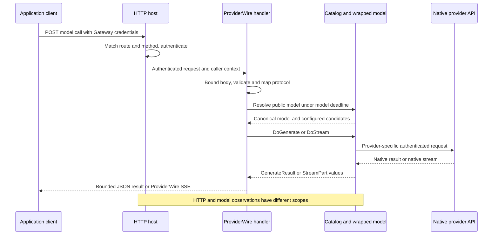
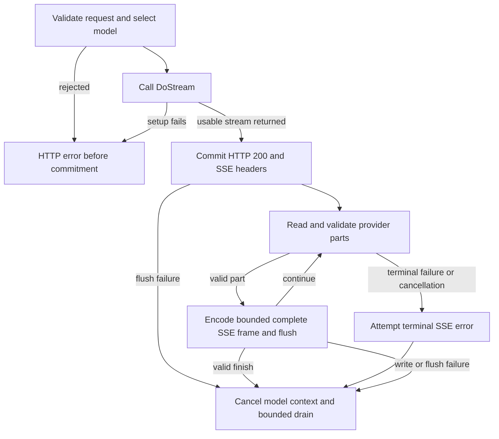

# How a request crosses AI Gateway

Suppose your application asks the public model `assistant` to summarize an
incident. The application knows the Gateway URL and its own access credentials.
The operator decides whether `assistant` calls Anthropic, OpenAI Responses, or
an OpenAI-compatible service, and whether it has backup models. The application
does not need the operator's provider API keys.

The protocol the client speaks and the provider the Gateway calls are separate
choices. They still need compatible capabilities: translating a request does
not make a provider support another provider's tools or options. This walkthrough
follows the runnable `grafana-ai-gateway` command. For setup, see
[calling Gateway](../providers/grafana-gateway.md) and
[running the container](../guides/ai-gateway-container.md). Unfamiliar terms have
[definitions and aliases in the glossary](gateway-glossary.md).

## The pieces and their boundaries

The shipped command accepts **ProviderWire V4**, the model-call protocol used by
the Go Grafana provider and the server-side Vercel Gateway client. It is not the
browser UI message stream protocol. A Go application can consume Gateway output
and then produce a separate [UI message stream](wire-protocol.md) for React.

This diagram groups components; it is not a timeline. Authentication wraps the
inbound handler, as the request sequence below shows.

The two protected API routes are `GET /api/v1/aisdk/config` for discovery and
`POST /api/v1/aisdk/language-model` for generation and streaming. `/live`,
`/ready`, and `/metrics` are operational routes. Cloud proxy mode uses separate
API and operational listeners. See the
[router](../../ai-gateway/cmd/grafana-ai-gateway/internal/service/router.go) and
[process composition](../../ai-gateway/cmd/grafana-ai-gateway/internal/process/process.go).

**Other inbound protocols are not wired into this command.** In particular,
`/v1/chat/completions`, `/v1/messages`, and `/v1/responses` are not registered
routes. An outbound Anthropic provider does not establish Claude Code support;
an outbound Responses provider does not establish Codex support. Those clients
need their own compatible ingress and end-to-end evidence. The
[Chat Completions adapter proposal](https://github.com/grafana/ai-sdk/pull/248)
is separate work, not an additional path in the diagram.

## Follow one request

Imagine `assistant` has an Anthropic primary and an OpenAI backup. The catalog
and wrapped model objects are built at startup; selection below looks up those
objects rather than constructing the whole chain for every request.

1. **The host identifies and authenticates the caller.** HTTP telemetry wraps
   dispatch. Route and method checks happen before authentication; authentication
   happens before body decoding. JWT mode verifies access tokens. Cloud mode
   trusts identity from an authenticating proxy and requires network isolation
   so callers cannot forge that identity directly. Gateway credentials identify
   the caller; provider credentials authorize the later native API call. See
   [authentication](../guides/gateway-authentication.md) and the
   [authentication middleware](../../ai-gateway/cmd/grafana-ai-gateway/internal/auth/auth.go).
2. **ProviderWire translates the request.** The handler validates protocol
   headers, reads a bounded body, checks UTF-8 and the request schema, and maps
   the body to `provider.CallOptions`. It separates the reserved `gateway`
   options from native provider options and checks tool-call history. Invalid
   input can fail before model selection. See the
   [handler](../../ai-gateway/providerwire/v4/handler.go) and
   [request mapper](../../ai-gateway/providerwire/v4/request.go).
3. **Selection resolves a public name.** A model deadline begins after request
   validation and covers selection plus model execution. `CatalogSelector`
   resolves `assistant` or an alias to its canonical model. The command uses
   operator-configured routes and rejects reserved Gateway controls; the caller
   cannot use those controls to select arbitrary providers or accounts. See
   [selection](../../ai-gateway/providerwire/v4/selection.go) and the
   [catalog guide](../../ai-gateway/docs/model-catalog.md).
4. **The wrapped model performs the call.** Logical observation surrounds the
   configured primary/fallback chain. Candidate-specific option checks and
   native adapters run within that chain. An adapter converts common call
   options into its provider's HTTP request and converts the response back into
   SDK values. Native options remain provider-specific; not every candidate
   consumes every namespace. See
   [catalog construction](../../ai-gateway/cmd/grafana-ai-gateway/internal/service/catalog.go)
   and [model observation](../../ai-gateway/cmd/grafana-ai-gateway/internal/service/model_observability.go).
5. **ProviderWire returns the result.** Unary calls use `DoGenerate`, then map
   and encode the complete response within its byte limit before writing
   success. Streaming calls use `DoStream` and the lifecycle below. This handler
   does not run the SDK's application tool loop: consumer-owned function calls
   return to the application for execution and a subsequent request. Provider
   tools may execute remotely. See the
   [response encoder](../../ai-gateway/providerwire/v4/response.go) and
   [tool guide](../guides/tools.md).

The SDK's high-level `GenerateText` collects `StreamText`; that is different
from the Gateway handler's direct unary `DoGenerate` path. Follow
[the SDK walkthrough](architecture.md) for application orchestration around
these model calls.

## Streaming, failures, and the point of no return

A stream has two distinct commitments. **Candidate selection** means fallback
has accepted one provider. **HTTP response commitment** means the server has
sent the status and headers and can no longer replace them with an HTTP error.

Configured Gateway fallback uses the default
[fallback implementation](../../fallback/fallback.go): it may advance after an
eligible setup failure or a stream that closes before its first part. The first
received part selects the candidate, even if it is only `stream-start` or an
error event. Later errors do not restart the chain. The SDK also offers opt-in
complete-stream buffering, but the command's catalog does not enable it.

For configured fallback, `DoStream` waits for candidate selection before
returning the usable stream. For a direct model, the handler may commit HTTP
success before the first provider part arrives. The
[stream runtime](../../ai-gateway/providerwire/v4/stream.go) supplies an empty
`stream-start` when needed, checks event ordering and bounds, and writes
complete `data: <JSON>` frames separated by a blank line.

A provider error event can be followed by more content and a valid finish. It
is different from a handler-terminal failure such as invalid ordering,
premature EOF, an oversized frame, or a deadline. After commitment, failures
must be represented in the stream if the writer is still usable; they cannot
change the HTTP status. A disconnected client may receive no final error at all.
Cancellation propagates through contexts, and cleanup drains remaining parts
only within configured time and count bounds. It cannot undo work already
performed by a remote provider or tool.

The handler bounds request bytes, encoded unary responses, stream frame bytes,
part counts, model duration, idle time, and cleanup. These checks live at
specific boundaries, including adapter-local encoding preflights. They are not
a single aggregate admission controller or a universal bound on decompressed
native HTTP bodies. Centralizing resource policy is a
[separate proposal](https://github.com/grafana/ai-sdk/issues/394).

## What the observations tell you

One HTTP request can contain several physical provider attempts but one logical
model call. Logs and metrics describe those different scopes. Optional client
execution overviews describe observed selection decisions and configured
identities; they do not prove that a selected stream completed. Token usage is
provider-reported accounting, not a complete count of all remote work after
retries or interrupted calls.

See [execution overviews and failures](../providers/grafana-gateway.md#inspect-execution-overviews-and-failures)
for access and privacy boundaries, and
[operator observability](../../ai-gateway/docs/text-observability.md) for logs,
metrics, and exporters. Native diagnostics can contain provider-authored text;
summary redaction is not a general filter for generated content or secrets.

## Existing code versus deployed capabilities

The reusable [request-only BYOK engine](../../ai-gateway/cmd/grafana-ai-gateway/internal/byok/model.go)
can construct models from request accounts. The command's process composition
still installs `CatalogSelector`, so that engine's existence does not establish
authenticated BYOK service support. Similarly, reusable middleware supports
policy hooks, but this command does not install every available SDK policy or
an aggregate admission controller.

This walkthrough is grounded in the router, process composition, handler, and
catalog linked above. Useful regression evidence includes
[authentication ordering tests](../../ai-gateway/cmd/grafana-ai-gateway/internal/auth/auth_test.go),
[configured fallback tests](../../ai-gateway/cmd/grafana-ai-gateway/internal/service/fallback_acceptance_test.go),
and [stream lifecycle tests](../../ai-gateway/providerwire/v4/stream_test.go).
The [parity coverage map](../../test/conformance/PARITY.md) distinguishes client
protocol evidence, synthetic native-provider tests, and live-provider evidence.

The registered upstream reference is recorded in
[upstream.yaml](../../test/conformance/upstream.yaml), including
`@ai-sdk/gateway` 4.0.103 and `@ai-sdk/provider` 4.0.21. The corresponding
[upstream Gateway client](https://github.com/vercel/ai/blob/eb77f09e3c06c28e860d92e0de941b143c2eecec/packages/gateway/src/gateway-language-model.ts)
serializes model calls and reads JSON or SSE. It establishes the client-facing
protocol, not Vercel's private hosted-service implementation or Grafana's
routing policy.

---

← [How a request runs](architecture.md) · [Docs index](../README.md) · [Gateway glossary →](gateway-glossary.md)
