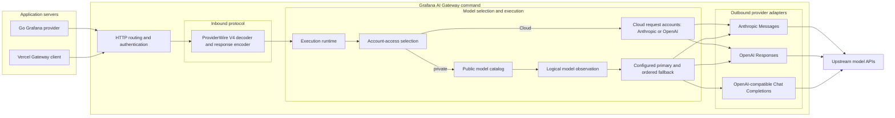
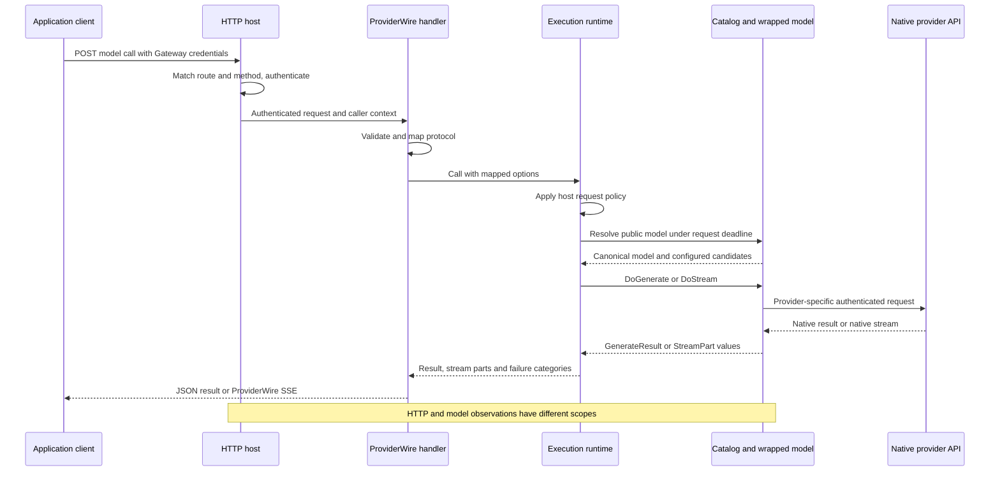

# How a request crosses AI Gateway

Suppose your application asks the public model `assistant` to summarize an
incident. The application knows the Gateway URL and its own access credentials.
The operator decides whether `assistant` calls Anthropic, OpenAI Responses, or
an OpenAI-compatible service, and whether it has backup models. On this private,
configured-account path, the application does not need the operator's provider
API keys. The separate Cloud path accepts caller-supplied Anthropic or OpenAI
credentials for each request (BYOK).

The protocol the client speaks and the provider the Gateway calls are separate
choices. They still need compatible capabilities: translating a request does
not make a provider support another provider's tools or options. This walkthrough
follows the runnable `grafana-ai-gateway` command. For setup, see
[calling Gateway](../providers/grafana-gateway.md) and
[installing the plugin](../../ai-gateway/README.md). Unfamiliar terms have
[definitions and aliases in the glossary](gateway-glossary.md).

## The pieces and their boundaries

The shipped command accepts **ProviderWire V4**, the model-call protocol used by
the Go Grafana provider and the server-side Vercel Gateway client. It is not the
browser UI message stream protocol. A Go application can consume Gateway output
and then produce a separate [UI message stream](wire-protocol.md) for React.

This diagram groups components; it is not a timeline. Authentication wraps the
inbound handler, as the request sequence below shows.

The command composes its routes from one route table. Each entry names a
method, a path under the prefix `/apis/{group}/{version}/namespaces/{namespace}`,
a telemetry label, the adapter's handler and the adapter's host-error writer.
Every entry gets the same access decision and request telemetry, and a refused
caller gets that adapter's permission document without its body being read. The
production table matches the committed manifest: `GET {prefix}/config` and
`POST {prefix}/language-model`. A request that matches no entry does no access,
selection or provider work, and is labeled `unmatched`.

Host failures use a closed set of categories (permission, internal, and BYOK
discovery unsupported), which each adapter writes in its own format. Discovery
is host-owned: the host lists the catalog for configured callers and returns the
BYOK-discovery error for BYOK callers, and the adapter only projects the listed
models into its document. The
[host contract](../../ai-gateway/internal/host/doc.go) lists what an adapter
supplies and what the host provides. The plugin host owns transport and any
operational endpoints, so there are no separate listeners and no `/live`,
`/ready`, or `/metrics` routes here. See the
[routes](../../ai-gateway/cmd/grafana-ai-gateway/internal/gateway/routes.go) and
[plugin composition](../../ai-gateway/cmd/grafana-ai-gateway/internal/gateway/gateway.go).

**Other inbound protocols are not wired into this command.** In particular,
`/v1/chat/completions`, `/v1/messages`, and `/v1/responses` are not registered
routes. An outbound Anthropic provider does not establish Claude Code support;
an outbound Responses provider does not establish Codex support. Those clients
need their own compatible ingress and end-to-end evidence. The
[Chat Completions adapter proposal](https://github.com/grafana/ai-sdk/pull/248)
is separate work, not an additional path in the diagram.

## Follow one request

Imagine `assistant` has an Anthropic primary and an OpenAI backup. The catalog
and wrapped model objects are built at startup; selection below looks up those
objects rather than constructing the whole chain for every request. This sequence
follows the private configured-account path; Cloud selection is described below.

1. **The host verifies the caller and the access decision maps it.** HTTP
   telemetry wraps dispatch. Route and method checks happen before the access
   decision; the decision happens before body decoding. The plugin host verifies
   the platform-delegated token against the platform signing keys
   (`GRAFANA_JWKS_URL` or `GRAFANA_JWKS`). `Decide` then maps the verified token
   and route namespace to account access under the configured `access_mode`
   (`cloud` or `self-hosted`): the token namespace must cover the route
   namespace, then the mode and the token's actor chain select configured, BYOK,
   or refused access. The delegated identity names the caller; provider
   credentials authorize the later native API call. See
   [authentication](../guides/gateway-authentication.md) and the
   [access decision](../../ai-gateway/cmd/grafana-ai-gateway/internal/auth/access.go).
2. **ProviderWire translates the request.** The handler validates protocol
   headers, reads the whole body, which the platform's route message size
   bounds, checks UTF-8 and the request schema, and maps
   the body to `provider.CallOptions` and checks tool-call history. The
   execution runtime then refuses credential-bearing call headers and removes
   the call-level `gateway` options, which only the selector reads. Every other
   provider-option namespace reaches the model unchanged. Invalid input can
   fail before model selection. See the
   [handler](../../ai-gateway/providerwire/v4/handler.go) and
   [request mapper](../../ai-gateway/providerwire/v4/request.go).
3. **Selection resolves a public name.** The shared
   [execution runtime](../../ai-gateway/internal/execution/runtime.go) selects
   and invokes the model for every API adapter, on the request goroutine. The
   request deadline, which Grafana's route deadline sets, covers selection plus
   model execution. One access-aware selector, `NewSelector`, serves every
   caller, so each adapter needs one runtime. For configured access it
   delegates to `CatalogSelector` to resolve `assistant` or an alias to its
   canonical model. This private path rejects reserved Gateway controls; its
   caller cannot switch to request accounts. See [service selection](../../ai-gateway/cmd/grafana-ai-gateway/internal/service/selection.go),
   [catalog selection](../../ai-gateway/internal/execution/selection.go), and the
   [catalog guide](../../ai-gateway/docs/model-catalog.md).
4. **The wrapped model performs the call.** Logical observation surrounds the
   configured primary/fallback chain. Candidate-specific option checks and
   native adapters run within that chain. When the inbound adapter supplied an
   option translator, each candidate first translates its own copy of the call
   options for its native protocol; host policy re-checks the result before the
   candidate's native option validation runs. An adapter converts common call
   options into its provider's HTTP request and converts the response back into
   SDK values. Native options remain provider-specific; not every candidate
   consumes every namespace. See
   [catalog construction](../../ai-gateway/cmd/grafana-ai-gateway/internal/service/catalog.go)
   and [model observation](../../ai-gateway/cmd/grafana-ai-gateway/internal/service/model_observability.go).
5. **ProviderWire returns the result.** Unary calls use `DoGenerate`, then map
   and encode the complete response once before writing success. Streaming calls use `DoStream` and the lifecycle below. This handler
   does not run the SDK's application tool loop: consumer-owned function calls
   return to the application for execution and a subsequent request. Provider
   tools may execute remotely. See the
   [response encoder](../../ai-gateway/providerwire/v4/response.go) and
   [tool guide](../guides/tools.md).

The SDK's high-level `GenerateText` collects `StreamText`; that is different
from the Gateway handler's direct unary `DoGenerate` path. Follow
[the SDK walkthrough](architecture.md) for application orchestration around
these model calls.

## Streaming, failures, and the point of no return

A stream has two distinct commitments. **Candidate selection** means fallback
has accepted one provider. **HTTP response commitment** means the server has
sent the status and headers and can no longer replace them with an HTTP error.

Configured Gateway fallback uses the default
[fallback implementation](../../fallback/fallback.go): it may advance after an
eligible setup failure or a stream that closes before its first part. The first
received part selects the candidate, even if it is only `stream-start` or an
error event. Later errors do not restart the chain. The SDK also offers opt-in
complete-stream buffering, but the command's catalog does not enable it.

For configured fallback, `DoStream` waits for candidate selection before
returning the usable stream. For a direct model, the handler may commit HTTP
success before the first provider part arrives. The execution runtime waits for
each part and owns the idle timer and cleanup. The
[ProviderWire stream encoder](../../ai-gateway/providerwire/v4/stream.go) supplies an empty
`stream-start` when needed, checks event ordering and validity, and writes
complete `data: <JSON>` frames separated by a blank line.

A provider error event can be followed by more content and a valid finish. It
is different from a handler-terminal failure such as invalid ordering,
premature EOF, an invalid value, or a deadline. After commitment, failures
must be represented in the stream if the writer is still usable; they cannot
change the HTTP status. A disconnected client may receive no final error at all.
Cancellation propagates through contexts, and cleanup drains remaining parts
only within a configured duration. It cannot undo work already
performed by a remote provider or tool.

Each resource limit has one owner. Grafana's plugin host owns the request
deadline, the request size, admission and, through the container, process
memory. The Gateway keeps only what it owns: 8 provider attempts per request,
checked when the catalog loads and when request keys are decoded; 16 MiB per
decompressed provider response that is not a stream, in the model transport;
and stream idle time and cleanup in the execution runtime. No API adapter
rejects or truncates output because of its size. See the
[limits](../../ai-gateway/README.md#limits) for the full list.

## What the observations tell you

One HTTP request can contain several physical provider attempts but one logical
model call. Logs and metrics describe those different scopes. Optional client
execution overviews describe observed selection decisions: configured
identities for configured models, and the requested destination with each
account attempt for BYOK calls. They do not prove that a selected stream
completed. Token usage is
provider-reported accounting, not a complete count of all remote work after
retries or interrupted calls.

See [execution overviews and failures](../providers/grafana-gateway.md#inspect-execution-overviews-and-failures)
for access and privacy boundaries, and
[operator observability](../../ai-gateway/docs/text-observability.md) for logs,
metrics, and exporters. Native diagnostics can contain provider-authored text;
summary redaction is not a general filter for generated content or secrets.

## Customer telemetry contracts

The internal [customer telemetry package](../../ai-gateway/cmd/grafana-ai-gateway/internal/customertelemetry/doc.go)
defines validation, policy, and discovery-cache contracts for future delivery to a customer's own
stack. It is not connected to request handling: changing a client's Gateway URL
does not yet activate this delivery. Existing operator telemetry continues through
the paths described above.

The contracts separate three decisions:

| Decision | Source and boundary |
| --- | --- |
| Where can a signal go? | A destination snapshot belongs to the authorized namespace and carries separate endpoints and opaque ingestion identities for generations, traces, metrics, and logs. A missing signal is unavailable. |
| May it be recorded? | An effective policy combines authoritative signal eligibility, mandatory service limits, and optional customer preferences. An endpoint alone grants no permission. |
| Which ingestion authority will it use? | A deployment-owned credential reference and rotation version are independent of recording policy. The contract carries no secret and does not reuse caller authentication or provider keys. |

An eligible signal with no customer preference receives the fixed
`metadata-only-v1` profile. Unknown eligibility, an explicit disablement, and
failed policy reads cannot enable recording. Expired policies and destinations
cannot be used for new recording; snapshots from another namespace cannot be
combined into a delivery target. Future policy resources can supply preferences
through this boundary without requiring a resource for customers using defaults.

The profile permits metadata-only generations and correlated model spans. It
excludes prompt, output, reasoning and tool content, raw errors, arbitrary
attributes, raw request/response data, and private provider/backend details.
Customer log recording is disabled even if a log destination is available.

The default metric profile is fixed:

| Instrument | Allowed dimensions |
| --- | --- |
| `gen_ai.client.operation.duration` | Operation name, closed error classification |
| `gen_ai.client.token.usage` | Operation name, token type |
| `gen_ai.client.time_to_first_token` | Operation name |

Dimension values must be normalized classifications, not arbitrary client or
provider text. No model or customer identity dimension is enabled. Usage and
first-token measurements depend on available observations; the profile does not
invent missing values. Expanding captured content, instruments, or dimensions
requires explicit compatibility review.

The internal cache starts empty and resolves an authorized stack on demand through
supplied destination and policy resolvers. Each component has its own validity,
refresh schedule, and shared in-flight lookup. Warm requests can reuse current
snapshots while refresh runs. Canceling a waiting request does not cancel another
request's lookup, and the cache does not retain caller context values or credentials.

Cold lookup waits have a finite metadata timeout. A request with a deadline must
have enough time left for that timeout plus configured inference headroom;
otherwise lookup returns a budget outcome without starting new work. The cache
never invokes or retries inference. Its explicit limits are deployment choices,
not measured defaults or an automatic guarantee of inference latency.

Positive snapshots refresh at the earlier of the configured refresh interval and
half their remaining lifetime, subject to a minimum retry interval. Valid negative
state and failures are rechecked at that retry interval. A short-lived snapshot
can expire before the next allowed attempt; recording then stops until usable
metadata returns. Destination and policy refresh are independent. Transient failure
preserves each old snapshot only until its original expiry. Observed disablement,
signal removal, authoritative denial, or invalid data takes effect for subsequent
cache reads immediately. A failed read never restores recording defaults.

Changes are observable only after refresh; this is not instantaneous revocation.
Already-returned snapshots and future recorder leases need their own validity and
lifecycle enforcement. Concrete adapters must map verified service responses to
the cache's bounded outcomes; no Cloud response format is assumed here.

Entry count is bounded, with at most one outstanding resolver call per component
per entry. Background refresh does not extend idle retention. Idle entries are
reclaimed once their actual resolver calls return. A timed-out call that ignores
cancellation remains charged to capacity and cannot spawn replacement calls.
The owner must close the cache with a finite shutdown deadline; closure cancels
lookups, wakes waiters, and stops admission and maintenance. Real adapters must
honor cancellation and bound their transports because Go cannot terminate arbitrary
resolver code.

These are executable contracts and cache behavior, not an exporter implementation
or proof of Cloud ingestion. Discovery field mappings, transport credentials,
export filtering, production cache wiring, and exporter lifecycle remain separate work.
No customer settings API, log exporter, full agent-workflow trace, or billing
accounting is supplied by this package.

## Existing code versus deployed capabilities

The command serves two account paths through one selector and one runtime.
The access decision chooses the path from the `access_mode` and the verified
token, not from a caller choosing a different model name:

- **Configured:** callers granted configured access use configured models and
  server-held provider credentials. In `self-hosted` mode this is any verified
  user or service account; in `cloud` mode it is an allowlisted internal
  service. They cannot switch to request accounts.
- **BYOK:** in `cloud` mode, other verified identities get request-scoped
  access; the selector decodes the provider/model destination and credentials
  from the call-level `gateway.byok` controls. The [BYOK engine](../../ai-gateway/cmd/grafana-ai-gateway/internal/byok/model.go)
  constructs an Anthropic or OpenAI model with request-local accounts and
  observation, and the selection carries the destination and account count
  that the BYOK execution overview is checked against. It does not consult the
  configured catalog or fall back to server-held keys. This host supplies no custom base-URL approval map.

See [service selection](../../ai-gateway/cmd/grafana-ai-gateway/internal/service/selection.go)
and [authentication configuration](../guides/gateway-authentication.md).
`Decide` refuses a token whose namespace does not cover the route namespace, so
a caller cannot reach another namespace's account path. Source and synthetic
tests establish service wiring, not production network isolation or live-provider
acceptance.
Reusable middleware supports policy hooks, but this command does not install
every available SDK policy or an aggregate admission controller.

This walkthrough is grounded in the router, process composition, handler, and
catalog linked above. Useful regression evidence includes
[access decision tests](../../ai-gateway/cmd/grafana-ai-gateway/internal/auth/access_test.go),
[configured fallback tests](../../ai-gateway/cmd/grafana-ai-gateway/internal/service/fallback_acceptance_test.go),
and [stream lifecycle tests](../../ai-gateway/providerwire/v4/stream_test.go).
The [parity coverage map](../../test/conformance/PARITY.md) distinguishes client
protocol evidence, synthetic native-provider tests, and live-provider evidence.

The registered upstream reference is recorded in
[upstream.yaml](../../test/conformance/upstream.yaml), including
`@ai-sdk/gateway` 4.0.116 and `@ai-sdk/provider` 4.0.29. The corresponding
[upstream Gateway client](https://github.com/vercel/ai/blob/b7f6255acaae7724adc0fd37aac3dae3f3466578/packages/gateway/src/gateway-language-model.ts)
serializes model calls and reads JSON or SSE. It establishes the client-facing
protocol, not Vercel's private hosted-service implementation or Grafana's
routing policy.

---

← [How a request runs](architecture.md) · [Docs index](../README.md) · [Gateway glossary →](gateway-glossary.md)
