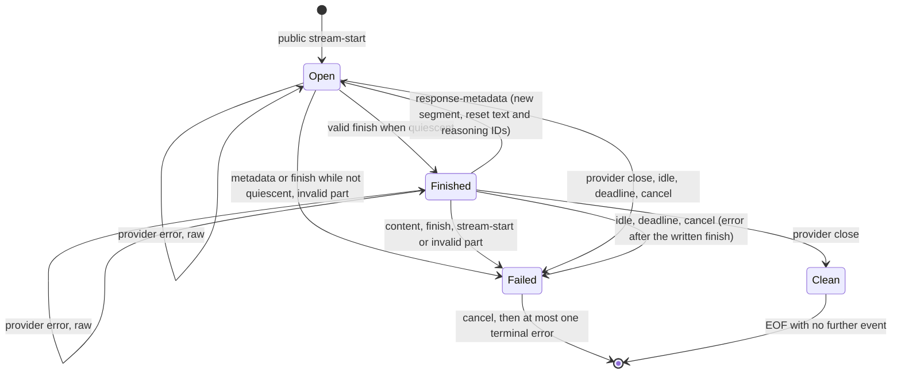

# Design

## Context

See proposal.md for motivation. Line references are to `main` at `2250fcff` (#532).

### Rules that produce the failures

| Rule | Code | Spec (`providerwire-v4-streaming-runtime`) |
| --- | --- | --- |
| At most one `response-metadata`, only before any output | `stream.go:534-546` rejects when `metadataSeen \|\| textStarted`. `textStarted` is set by text (`:562`), source (`:521`), custom (`:530`), reasoning (`reasoning.go:82`), tools and approvals (`stream_tools.go:131`, `:172`) | "Native response metadata and text block state" (L158), scenario "Metadata placement is invalid" (L194) |
| Text IDs unique for the whole stream | `usedIDs` (`stream.go:551`, `:560`) | L164, "Canonical telemetry and sequential text lifecycle" (L216) |
| Reasoning IDs unique for the whole stream | `usedReasoningIDs` (`reasoning.go:68`, `:85`) | "Synthetic terminal adapter errors" scenario "Reasoning lifecycle violation" (L315) |
| First `finish` ends the response | `stream.go:637` returns `streamPartFinished`, and `handleStreamPartResult` (`:443-452`) stops the loop. The deferred cancel and drain (`:249-252`) then suppress the rest | "Finish validation and terminal authority" (L224), "Finish usage metadata and final public authority" (L256), "Immediate EOF and post-finish provider suppression" (L264) |
| Every provider close is premature | `consumeStreamParts` (`:427-441`) sends `streamWaitClosed` to `writeStreamTerminalForWait` (`:701-710`), which writes `internal_error`. No clean-EOF path exists because EOF is never reached after a `finish` | "Synthetic terminal adapter errors" (L311) |
| `finish` beats a later timeout or cancellation | Implicit, because the handler stops reading after a `finish` | "Cancellation and timeouts" (L379, L390, L414), "Streaming terminal authority and scheduler race boundary" (L426) |

The `finish` predicate (`stream.go:599-611`) rejects:
- an open tool input (`toolInputOpen`);
- a tool preview series that has not reached its final result (`toolResultPreliminary`, for current and history tools);
- an open text block (`activeID`);
- an open reasoning block (`reasoningIDs`).

Tool state (`state.tools`, `state.history`) and `approvalIDs` are kept for the whole stream, and tool IDs never reopen (`stream_tools.go:77-133`, `:142-174`).

### What the seven fixtures contain

Verified from the committed `expected-provider-parts.jsonl`. Each file has one JSON line, one model call and raw parts included. R stands for `response-metadata` and F for `finish`, ignoring raw parts.

| Fixture | Parts | Shape | Repeated text-start ID | Tool result in a later segment |
| --- | ---: | --- | --- | --- |
| `anthropic/upstream/programmatic-tool-calling` | 620 | (R…F)×15 | none | `srvtoolu_01Mz…`: call in segment 1, result in segment 15 |
| `anthropic/upstream/tool-search-bm25` | 92 | R…F R…F | `0` ×2 | none |
| `anthropic/upstream/tool-search-regex` | 101 | R…F R…F | none | none |
| `anthropic/upstream/tool-search-deferred-bm25` | 228 | (R…F)×3 | `0` ×2 | `srvtoolu_01Fj…` |
| `anthropic/upstream/tool-search-deferred-regex` | 236 | (R…F)×3 | `0` ×2 | `srvtoolu_01H4…` |
| `openai/upstream/reasoning-encrypted-content` | 208 | R…R…R…R…F | none | none |
| `openai/upstream/shell` | 351 | R…R…F | none | none |

Other facts that shape the design:
- **Between segments in Anthropic fixtures**, exactly one raw part (`message_start`) sits between each `finish` and the next `response-metadata`.
- **In the OpenAI fixtures**, each later `response-metadata` follows a closed tool call with no `finish` in between.
- **At every `response-metadata` and `finish`**, no text, reasoning or tool-input block is open and no preview series is pending.
- **Across all seven fixtures**:
  - no provider error parts appear;
  - no reasoning or tool-call ID repeats;
  - the last part that is not raw is always a `finish`.
- **Each `finish` carries its own message's usage.** For example, programmatic-tool-calling has input 3369 and output 725 on the first `finish` and input 4551 and output 197 on the last.

### Consumers and observers

- **The pinned `@ai-sdk/gateway@4.0.116` client** forwards every decoded part in a `TransformStream` and does not close on `finish`: [`gateway-language-model.ts` L147-180 at `b7f6255a`](https://github.com/vercel/ai/blob/b7f6255acaae7724adc0fd37aac3dae3f3466578/packages/gateway/src/gateway-language-model.ts#L147-L180).
- **`ai@7.0.143`** handles each `finish` and each `response-metadata` chunk in stream order within one model call (`stream-language-model-call.ts` L606, L837).
- **The Go client** (`providers/grafana/stream.go:69-118`) is stateless per event. It ends only at EOF, a read error, an invalid event or the context.
- **Root-repo middleware observes native parts before the runtime.** It wraps the model in `ai-gateway/cmd/grafana-ai-gateway/internal/service/model_observability.go:226-301`:
  - Logger (`middleware/logger/stream.go:265`) and Prometheus (`middleware/prometheus/stream.go:153`) observe every part. They aggregate usage with `internal/streamusage` (per-counter maximum, `usage.go:18-35`) and keep the last finish reason.
  - Agent Observability stops observing and finalizes at the first `PartFinish` (`middleware/agentobservability/recording.go:239-256`).
  - These are separately versioned modules (`middleware/*/go.mod`), plus `internal/streamusage` in the root module. The plugin builds them from workspace source through `go.gateway.work`.

## Goals / Non-Goals

**Goals:**
- The Gateway forwards the provider stream as the direct provider emits it, so its output reproduces the direct oracle for sequential responses.
- The strict state validation from #98 is kept and scoped to a segment, not dropped.
- Every existing bound, the single cleanup owner and no-replay-after-commit stay as they are.

**Non-Goals:**
- Any change in a provider adapter, including the Anthropic adapter's handling of overlapping `message_start`, or in `providers/grafana` or the TypeScript client.
- Changing the strongest-value usage semantics of logs and metrics, or fixing Agent Observability in this PR (see D10).
- A new limit of any kind: part, segment, byte, frame or grace period.

## Decisions

### D1. Explicit segment state replaces `metadataSeen` and `textStarted`

`streamState` gains one lifecycle field with two phases:
- `segmentOpen`: content is allowed. This is the initial phase after the public start.
- `segmentFinished`: the last lifecycle part written was a valid `finish`.

Lifecycle parts are every part except raw parts and provider error parts. `metadataSeen` and `textStarted` are removed, because their only reader was the `response-metadata` guard (`stream.go:535`). The per-segment ID sets are renamed so that their scope is visible:
- `usedIDs` becomes `segmentTextIDs`;
- `usedReasoningIDs` becomes `segmentReasoningIDs`.

A segment starts at the public start and at every accepted `response-metadata`.

| Phase | Part | Condition | Result |
| --- | --- | --- | --- |
| Open | `response-metadata` | quiescent and valid identity | written; new segment; per-segment ID sets cleared |
| Open | `response-metadata` | not quiescent | adapter failure |
| Open | text, reasoning, tool, approval, source, custom, reasoning file | existing family rules, with text and reasoning IDs checked per segment | written |
| Open | `finish` | quiescent and valid | enriched (D7) and written; phase becomes Finished |
| Open | `finish` | otherwise | adapter failure |
| Finished | `response-metadata` | valid identity (quiescence holds after a `finish`) | written; new segment; phase becomes Open |
| Finished | any other lifecycle part, including `finish` and content | none | adapter failure (D4) |
| Either | provider error | not a recovered panic | written in place; phase unchanged (D4) |
| Either | provider error | recovered panic (`streamrecover.Is`) | adapter failure, as today |
| Either | raw | none | written if requested and valid, otherwise dropped; phase unchanged |
| Either | `stream-start` after the first part | none | adapter failure, as today |

Consecutive `response-metadata` parts are accepted, and each opens an empty segment. The predicate does not need extra state, and the direct provider would forward them. This is a choice made here and not exercised by any fixture.

Alternatives:
- *Delete `metadataSeen` and accept any metadata anywhere.* Rejected by the issue and by #98's rationale: metadata in the middle of an open block makes block ownership ambiguous. The quiescence check keeps that protection.
- *Keep "the first metadata must precede output" and allow later metadata only after a `finish`.* Rejected: the OpenAI shape puts later metadata after output with no `finish`. Telling a "late first metadata" apart from a "new segment" needs state that protects no client.

### D2. One quiescence predicate for `finish` and `response-metadata`

The check at `stream.go:599-611` moves into one `streamState` method, used by both the `finish` and the `response-metadata` branches. It is true when no tool is in `toolInputOpen` or `toolResultPreliminary`, no history tool is in `toolResultPreliminary`, `activeID` is empty and `reasoningIDs` is empty. `finish` additionally keeps its own checks: warnings, nil reason or usage, reason and usage validity, and metadata validity.

`response-metadata` while anything is open fails safely. This covers malformed overlapping starts as the Gateway would see them: a second message's metadata arriving while the previous message's block is open. Text-start while text is open already fails (`stream.go:548`). A Gateway-side adapter defect therefore cannot merge two messages' blocks silently. Only the synthetic placement tests (task 2.2) exercise metadata while a block is open. The upstream `overlapping-message-start` case does not: the Anthropic adapter emits its own provider error after the second raw `message_start` and then closes, before any second `response-metadata` (`test/conformance/testdata/anthropic-stream-parts/expected-parts.jsonl:12`). Through the Gateway that case is a provider error written in place followed by a premature-close `internal_error`.

### D3. Terminal outcomes

| Outcome | Last lifecycle part is not a valid `finish` (Open, or no part yet) | Last lifecycle part is a valid `finish` (Finished) |
| --- | --- | --- |
| Provider channel close | premature close: cancel, one `internal_error` | clean EOF |
| Idle timeout | cancel, then one timeout error | cancel, then one timeout error after the written `finish` (D5) |
| Request deadline | cancel, then one timeout error | cancel, then one timeout error after the written `finish` (D5) |
| Request cancellation | cancel, then one cancellation error if writable | cancel, then one cancellation error after the written `finish` if writable (D5) |
| Adapter failure (invalid part, lifecycle violation, encoding failure, recovered panic) | cancel, one `internal_error` | cancel, one `internal_error` after the written `finish` (D4) |
| Writer failure | cancel, no further write | cancel, no further write |

Only the provider-close row depends on the phase. In every row the model context is canceled before any terminal frame is encoded, and cleanup stays with the deferred owner in `serveStream` (`stream.go:249-252`). `streamPartFinished` goes away: `finish` returns `streamPartContinue` after setting the phase, and `consumeStreamParts` decides the outcome when the wait ends. A close consults the phase; idle, deadline and cancellation keep `writeStreamTerminalForWait` unchanged.

### D4. Parts after a `finish`, including provider errors

After a `finish` only these may follow:
- `response-metadata`;
- raw parts;
- provider error parts;
- provider close.

Any other part fails safely. The written `finish` stays in place, and one terminal `internal_error` follows it. A second `finish` without new metadata is also invalid. Neither shape needs anything else after a `finish`: Anthropic sends `message_start` raw and then metadata, and OpenAI only finishes at EOF. Requiring metadata keeps segment boundaries explicit.

**Provider error after a `finish`.** The error is forwarded in place, classified as usual, and does not change the phase. So:
- `finish, error, EOF` ends with a clean EOF;
- `finish, error, metadata, …` continues;
- `finish, error, text` fails safely.

Rationale:
- "Ordered non-terminal provider errors" already makes provider errors lifecycle-neutral everywhere. One rule is easier to reason about than a special case.
- The direct oracle forwards such an error unchanged, so parity requires writing it.
- Turning it into a lifecycle defect would add a synthetic `internal_error` after a real classified error. That hides the provider's own classification behind a generic one and duplicates the terminal signal.
- The client still sees the error, so nothing is hidden.

Alternatives:
- *Suppress parts after a `finish`, as today.* Rejected: it is the behavior that truncates the Anthropic fixtures.
- *Treat the error as output after the `finish`, so EOF becomes premature.* Rejected for the reasons above.
- *Accept content after a `finish` without metadata as an implicit new segment.* Rejected: it is not needed by any shape, and it would let a provider that keeps emitting content after a `finish` pass as valid.

### D5. `finish` followed by a provider that does not close

Idle timeout, request deadline and request cancellation keep their normal terminal behavior in both phases. After a written `finish`:
- idle timeout or request-deadline expiry cancels the model context and writes the normal timeout error after the `finish`;
- request cancellation behaves as today: it cancels, and writes a cancellation error only if the writer is still usable;
- the written `finish` is never retracted.

Only provider close is phase-dependent: it is a clean EOF when the last lifecycle part is a valid `finish`. This revises parent decision 3 after the round-1 review.

Rationale:
- The runtime cannot know a `finish` is the final one until the provider closes. In the Anthropic shape every `finish` except the last is followed by more messages, so a clean end on a stall after any `finish` would turn a timing-dependent cut between segments into a response that looks complete. That is the silent truncation #393 reports.
- A direct caller whose timeout fires before the provider closes sees an abort error, not success. Writing the timeout error matches that.
- It removes the phase-dependent branches from the cancellation, race and terminal-error requirements and from the observability delta.

It adds no new limit. When a part and a timer become ready together after a `finish`, either applicable outcome may win, consistent with the existing "no scheduler-level precedence" rule.

Alternatives:
- *End cleanly when the idle timer, the deadline or cancellation fires after a `finish` that is the last lifecycle part (the original decision 3).* Rejected: it makes a stall between segments indistinguishable from a complete response, which is timing-dependent silent truncation between segments, and direct callers see an abort error in that case instead.
- *A short post-finish grace period, or look ahead for one more part.* Rejected: it is a new limit with an arbitrary value, and it still truncates silently when the grace period ends between segments.

### D6. Identifier scope

- **Per segment:** text-start IDs and reasoning-start IDs. The per-segment sets are cleared when a segment starts, which only happens while quiescent, so no open block is affected. Three fixtures reuse text ID `0`. No fixture reuses reasoning IDs, but reasoning blocks are per message for the same reason as text blocks.
- **Per stream:**
  - tool IDs, covering tool-input and tool-call (`state.tools`);
  - history-seeded tools (`state.history`);
  - approval IDs (`state.approvalIDs`).

  A provider-executed call in segment 1 receives its result in segment 15 in programmatic-tool-calling, so the tool state must survive segment boundaries. Tool IDs still never reopen, in any later segment.

Alternative: *scope tool IDs per segment.* Rejected: it would drop the open call needed to accept the cross-segment result, and it would allow ambiguous duplicate calls.

### D7. Usage, `finish` metadata and execution enrichment

- **Each `finish` is validated and forwarded on its own.** That covers normalized usage, `usage.raw` and `providerMetadata`, including Anthropic `providerMetadata.anthropic.safeguardResults`. The wire carries no summing, merging, running totals or rewriting. Clients and `ai@7.0.143` treat each `finish` as the provider sent it, as with the direct provider.
- **Every written `finish` carries the same compact `providerMetadata.gateway.execution` overview.** The overview is the one snapshotted at the first part (`stream.go:390`, `:627-629`), and a native `gateway` namespace is relocated per frame. The last `finish` cannot be identified before EOF, so enriching only it would need buffering or lookahead.

Alternatives:
- *Enrich only the first `finish`.* Rejected: clients usually read the last `finish`.
- *Sum usage into the last `finish`.* Rejected: it diverges from the direct oracle and double-counts providers that report cumulative counters.

### D8. Bounds, cancellation, cleanup and fallback

- **No new limits.** `Limits` keeps only `StreamIdleDuration` and `StreamDrainDuration` (`handler.go:41-50`). No part, segment, byte or frame limit is reintroduced (#518, #532).
- **The idle timer** restarts after every represented part in every segment, as today (`stream.go:439`).
- **The request deadline** covers the whole stream across segments.
- **The drain** starts only after a terminal outcome. Normal consumption after a `finish` is reading, not draining.
- **A provider that keeps emitting valid segments** is bounded by the request deadline, like one that keeps emitting text deltas today. With no platform deadline it runs until close, cancellation or idle, which "No platform deadline" in gateway-resource-policy already states.
- **Cleanup has one owner.** The deferred `cancel` plus `startStreamDrain` in `serveStream` remains the only cleanup owner. Clean-end paths return to it. Cancel still precedes every terminal write.
- **Fallback is untouched.** Fallback selection happens at the first part (gateway-ordered-text-fallback "Fallback selection and first-part relay are authoritative"). Later segments are later parts of the same selected candidate and never re-enter selection. A failure in a later segment never triggers another candidate or replay.

### D9. Latency

- Each part is written and flushed when it is read. There is no lookahead or buffering, and time to first output is unchanged.
- EOF moves from the first `finish` to provider close. The in-repo adapters emit each `finish` as their last act for a native message or response, and their stream goroutines close the channel when the SSE body ends (`defer close`):
  - `providers/anthropic/convert_stream.go:529` (per `message_stop`, channel closed in `anthropic/model.go:140`);
  - `providers/openai/stream_adapter.go:841` (`flush`);
  - `providers/bedrock/convert_stream.go:567` (`emitFinish`);
  - `providers/openai-compatible/stream.go:433` (`flush`).
- A provider that never closes after its last `finish` holds the response for up to the idle duration, or until the request deadline, and then ends with a timeout error after that `finish` (D5). Both registered clients have already received the `finish`.

### D10. Observability and the module boundary

What the Gateway shows after this change, for a stream with several segments:
- **Logs and metrics** observe every part of every segment:
  - usage is the per-counter strongest value across all usage-bearing parts, as specified today;
  - the finish reason is the last one;
  - part counts include all segments;
  - time to first output is unchanged.
- **Stream outcome.**
  - A normal stream ends at upstream close without the runtime having canceled the model context. This removes today's race in which the runtime's post-finish cancel could make observers classify a completed stream as canceled (`middleware/logger/stream.go:86`).
  - A `finish` followed by a stalled provider (D5) is observed at the model boundary the same way as a stall before any `finish` is today:
    - when the request deadline expires, the logger records outcome `timeout` and metrics record `status=canceled` with `errorType=context_deadline_exceeded`;
    - when the idle timeout fires, the logger records outcome `cancelled` and metrics record `status=canceled` with `errorType=context_canceled`. The idle timeout calls `cancel()` on the model context (`ai-gateway/providerwire/v4/stream.go:209`, `:430-431`). The logger classifies through `outcomeForContextErr` (`middleware/logger/stream.go:135`, `:163-167`), which gives a timeout only for `context.DeadlineExceeded`. Metrics classify through `classifyContext` and `classifyError` (`middleware/prometheus/stream.go:113-116`, `middleware/prometheus/errors.go:46-52`, `:72-78`), which have no timeout status.

    In both cases the wire carries the written `finish` followed by one timeout error.
- **Agent Observability** finalizes one generation at the first `finish`. Its usage, finish reason and timing reflect the first segment only. Later segments still pass through unchanged.

The last point makes the existing gateway-text-observability finalization and usage-aggregation text false for Agent Observability. The delta states the behavior precisely as a recorded limitation instead of hiding it: the "Logical text lifecycle semantics" body says logs and metrics finalize at close while Agent Observability currently finalizes at the first `finish` and excludes later segments' usage, and the "Usage is split across stream parts" scenario is qualified the same way, so every sentence stays true until the follow-up lands. The fix lives in `middleware/agentobservability`, a separately versioned module with its own spec (`agent-observability-middleware`). It is registered as an independent, separately green follow-up issue:
- finalize at upstream close or a terminal outcome;
- aggregate usage across every usage-bearing part;
- keep the last finish reason;
- keep "end before downstream EOF";
- remove the limitation from gateway-text-observability in the same PR.

If that follow-up lands first, this change drops the limitation clauses before archive. Landing it first is preferable: finalizing at close is also correct for single-`finish` streams, so the follow-up can go green on its own, and it would keep this delta from writing a known defect into the spec as a SHALL.

Whether logs and metrics should sum rather than take the maximum across segments is a product decision with billing implications. It is left unchanged and out of scope.

### D11. Delivery and release intent

- **This lands as its own PR after #397**, which is done.
- **Acceptance** is the evidence in D13. The plugin host mounts the same `providerwire/v4` handler that the replay tests exercise, and this change touches neither routing, authentication nor the route deadline, so no plugin-host run is part of this change.
- No skip list, exclusion or `knownGaps` entry is added.
- **Release:** the PR title is `feat(ai-gateway)!: forward sequential response segments in one stream`. It is breaking because the public stream lifecycle changes: EOF timing, repeated events and post-finish failures. The Agent Observability follow-up carries its own scope and release intent.

### D12. Upstream parity classification

The reference is `test/conformance/upstream.yaml`:
- upstream `b7f6255acaae7724adc0fd37aac3dae3f3466578`;
- `ai@7.0.143`, `@ai-sdk/anthropic@4.0.82`, `@ai-sdk/openai@4.0.96`, `@ai-sdk/gateway@4.0.116` and `@ai-sdk/provider@4.0.29`.

At that commit the fixture helpers send each whole `.chunks.txt` as one mock response:
- [Anthropic L52-63](https://github.com/vercel/ai/blob/b7f6255acaae7724adc0fd37aac3dae3f3466578/packages/anthropic/src/anthropic-language-model.test.ts#L52-L63);
- [OpenAI Responses L254-266](https://github.com/vercel/ai/blob/b7f6255acaae7724adc0fd37aac3dae3f3466578/packages/openai/src/responses/openai-responses-language-model.test.ts#L254-L266).

The direct oracle is the committed provider parts. Upstream has no server lifecycle oracle, because the Vercel Gateway service is private.

| Difference | Classification |
| --- | --- |
| First-finish EOF and single-metadata rule (#98) | A former intentional deviation, now an implementation bug against the full registered direct oracle. This change removes it. |
| Forwarding valid sequential segments unchanged | Parity-preserving. |
| Quiescence, per-segment ID uniqueness, stream-global tool IDs, no content after `finish` without metadata | Intentional Gateway strictness: a Go extension, the strict server dialect established by #98. It is observable only for malformed input, no registered fixture exercises it, and it needs no `knownGaps` entry. |
| Agent Observability first-segment generation | Coverage gap in a Go extension, tracked by #582 (D10). Not an upstream surface. |

`PARITY.md` stays unchanged: no surface is added or removed, and the "AI Gateway" evidence location does not change.

### D13. Evidence and its limits

1. **Focused Go tests** in `ai-gateway/providerwire/v4`, with synthetic parts:
   - intermediate and final `finish` and their usage;
   - sequential metadata;
   - per-segment and stream-global IDs;
   - overlapping starts;
   - premature close;
   - `finish` followed by idle, deadline or cancel, including a stall between segments, each ending with the terminal error after the written `finish`;
   - provider errors after `finish`;
   - invalid parts after `finish`.

   Raw bodies are checked with `requireStreamBodyMatchesSchema` against `schema/stream_event.json`.
2. **Handler replay of the committed goldens.** A Go test reads each fixture's `expected-provider-parts.jsonl` read-only, decodes the parts with `provider.StreamPart.UnmarshalJSON`, serves them through the real handler with `includeRawChunks`, and compares the written events part by part. Only the documented ProviderWire projections are applied: timestamp encoding, the added execution overview and raw credential projection. Any presence adjustment the comparison needs, such as absent versus `false` `isError` or an omitted `providerExecuted: false`, is named per case in the test, or the test states that the case needs none. This is mock-stream proof of the runtime, independent of the adapters.
3. **Labeled synthetic upstream cases** from `test/conformance/testdata/anthropic-stream-parts`: `consecutive-messages` and `overlapping-message-start`. `consecutive-messages` exercises two clean segments. `overlapping-message-start` exercises a provider error written in place followed by a premature-close `internal_error`, not metadata while a block is open (D2); only the task 2.2 synthetic tests claim that path.
4. **Cross-language replay through the real adapters and the real handler.** The seven fixtures are added to the testserver `registerRecordedUsage` list and to the `runtime-integration.test.ts` replay loop. Both clients must reproduce the unchanged `expected.jsonl`, and the native requests must equal `expected-requests.jsonl`. The fixture configs are not edited: the testserver and the replay loop apply the conformance runner's defaults instead, namely the `"test"` prompt when a config has none (`test/conformance/runner.go:1179-1182`, `test/conformance/tools/generate.mts:375`, `:381`, `:513`) and the runner's projection of `providerTools` and provider options, which the Go client currently drops for provider tools (tasks 5.1, 5.2).
5. **A deterministic testserver scenario, `sequential-segments`,** with Anthropic and OpenAI shapes:
   - raw SSE frames are checked with `validateStreamEvent`;
   - UI chunks from both clients are checked with `uiMessageChunkSchema`;
   - the assembled messages are asserted.

   It lives in `ai-gateway/test/providerwire-v4` (node:test via `tsx --test`, under the `test:client` script), not in `test/integration/`, which AGENTS.md names as the default for wire scenarios. `test/integration/testserver` is the root SDK's server and cannot import the Gateway handler: the module boundary is one-way (`mise run verify-ai-gateway-boundary`), and `mise run verify-sdk-gateway-isolation` builds and tests the SDK without Gateway source. Every existing Gateway ProviderWire cross-language scenario (sources, custom, reasoning, recorded replay) already lives in this harness, which runs both registered clients against the real handler.

All of the above is mock-stream or replay evidence through the handler, not a plugin-host run. None of it claims that live providers emit these combined sequences in one HTTP response. Live acceptance is out of scope.

### Capabilities reviewed and left unchanged

| Capability | Why it stays |
| --- | --- |
| `gateway-reasoning-content` | Its requirements cover concurrent blocks and telemetry exclusion and say nothing about reuse across the stream. The reuse rule lives in the streaming runtime scenario this change modifies. |
| `gateway-attempt-failure-evidence` | "stream finish SHALL optionally carry `providerMetadata.gateway.execution`" holds for every `finish`, and the error-ordering scenarios are unchanged. The per-`finish` rule is added in the streaming runtime. |
| `gateway-resource-policy` | The idle and drain durations, the request deadline, "No platform deadline" and "Many provider parts" all still hold. "Execution time bounds", scenario "Request deadline ends the call" (`openspec/specs/gateway-resource-policy/spec.md:34-37`), holds unchanged: a deadline during stream consumption, including after a written `finish`, cancels the model context and writes a terminal event if the writer is still usable (D5). The segment bound is added in the streaming runtime. |
| `providerwire-v4-http-contract` | "Finish followed by clean EOF is consumed" and the replay scenarios still describe true behavior. A sequential probe is evidence, not a contract change. |
| `gateway-ordered-text-fallback` | First-part selection and no-replay already cover later segments. |
| `gateway-provider-tools` | "authoritative finish" in "Bounded preliminary lifecycle" still holds: a written `finish` is never retracted, and a pending preview still blocks `finish`. Its stale "frame/part limits" wording predates this change and is left to its owner. |
| `gateway-raw-output`, `grafana-gateway-client`, `gateway-tool-approvals`, `gateway-execution-overview`, `gateway-plugin-telemetry` | They contain no rule about the first `finish` or a single metadata part. |

The stale "bounded by the provider-part limit" phrase in gateway-streaming-function-tools "Bounded tool input lifecycle" predates #518. Because this change rewrites that block, it becomes "ID tracking SHALL NOT accumulate input deltas", matching the runtime spec's statement that no provider stream-part count is taken. The same stale wording in `gateway-provider-tools` is not in a block this change modifies and stays with its owner.

## Risks / Trade-offs

- **A provider that never closes after its `finish` now gets a timeout error** after the idle duration (30s) or at the request deadline, where it previously ended cleanly at once. The `finish` itself is still written immediately and never retracted.
  - Mitigation: the in-repo adapters emit `finish` last for each native message or response and then close when the SSE body ends (D9: `anthropic/convert_stream.go:529`, `openai/stream_adapter.go:841`, `bedrock/convert_stream.go:567`, `openai-compatible/stream.go:433`).
  - Task 3.4 audits Gateway test models and testserver models that keep their channel open; tests cover a non-closing provider with bounded latency and cleanup.
- **A deadline, idle timeout or cancellation between segments now ends with an error after a written `finish`.** A client that treats any error as failure may discard the segments it already received.
  - Mitigation: this is what a direct caller sees when its timeout fires before the provider closes, and it keeps a timing-dependent cut from looking like a complete response (D5).
- **Content after a `finish` now produces a terminal `internal_error`** instead of silent suppression, which some consumer may treat as a failure.
  - Mitigation: no registered fixture or adapter produces it. It replaces hidden data loss with an explicit signal.
- **Agent Observability undercounts multi-segment streams** until the follow-up lands.
  - Mitigation: stated in the spec delta and the docs. The follow-up is separately green, and the plugin picks it up through the workspace build.
- **Strongest-value usage in logs and metrics understates the total across segments** for providers that report per-message usage.
  - Mitigation: these are existing semantics, documented here. Changing them is a separate decision.
- **Existing tests encode the old rules**, and some keep passing for the wrong reason. A metadata part followed by EOF now fails as a premature close, not as misplaced metadata.
  - Mitigation: task 2.8 names each test and rewrites it to assert the new behavior directly.
- **Test models that keep their channel open after `finish`** now wait for the idle timer and end with a timeout error.
  - Mitigation: task 3.4 audits them, primarily by comparing test timings with the base revision, so they close, keeping such waits in the dedicated non-cooperative tests.

## Migration Plan

1. Clients need no change. Consumers that stop reading at the first `finish` keep working but miss later segments, as with the direct provider.
2. Operators see more complete streams. A custom Agent Observability consumer should read the D10 limitation.
3. Rollback is a revert of this PR. There is no persisted state.

## Open Questions

- The issue number of the Agent Observability follow-up (D10) is assigned when it is filed. Task 6.2 files it before this PR leaves draft.
