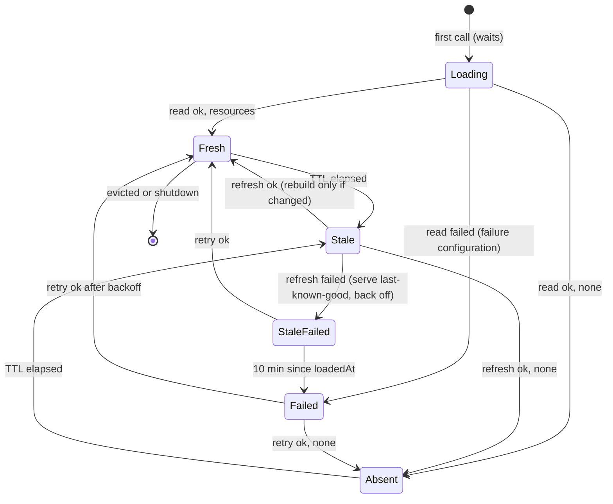

# Design

## Context

- Registered baseline: not parity-sensitive (see proposal). Platform references: grafana-app-sdk `v0.60.16` and `k8s.io/client-go v0.37.1`, both already in the Gateway's build list.
- `plugin.Run` builds the kubeconfig with `BuildKubeConfig` from `API_ACCESS_*` (falling back to a zero `rest.Config` with a warning), then calls the app provider once, before it serves anything. `Gateway.Provider()`'s callback receives it as `app.Config.KubeConfig` and passes it to `simple.NewApp`. Otherwise it's unused.
- With token exchange, the app-sdk transport exchanges on behalf of the caller when the request context carries `types.AuthInfo` or an ID token. Otherwise it exchanges as the plugin, with namespace `*`. The plugin v3 adapter puts the verified caller's `AuthInfo` on every route and admission context. `context.WithoutCancel` keeps that value.
- `extensionhost.Host` builds every enabled instance in `New` from the `Plan`. It precomputes `lists` per key ownership and picks them in `Compose(selection)`, which has no context. The pipeline already reads request info from the invocation context (`RequestInfo(ctx)`, including `Namespace`). Close runs only at shutdown.
- `Plan` enables a tenant definition only when `EnabledByDefault` is set, with `{}`. A tenant type without a schema takes no member and gets `{}`.
- The `Middleware` spec is a typed union: `type`, `enabled` and at most one member, named after the type in lowerCamel case (`tenanttype.Type.Member`), holding its configuration. `tenantconfig.DecodeSpec` decodes a raw spec without decoding members into Go types, so numbers stay exact; admission and the reader share it.
- app-sdk `v0.60.16` `simple.KindValidator.Validate` returns only `error`. The adapter doesn't expose the protocol's `warnings`.
- The protocol test host serves token exchange for access policies (`AddAccessPolicy`, `TokenExchangeHandler`) and get, create, update and delete for kinds, but not list.
- Go 1.27, so tests use `testing/synctest` (already used in the root module) for fake time.

## Goals / Non-Goals

**Goals:** apply each namespace's stored configuration without trusting callers; never fail open on read failures; bound memory, API load and staleness; keep one instance per extension and pass each namespace's configuration to calls as data; keep the shipped build inert until it registers a tenant extension.

**Non-Goals:** an all-namespace informer or watch; a status writer; operator-configurable cache constants; admission warnings through app-sdk (see Decision: admission without API access); shipped tenant extensions (#766); stack-catalog sources (#757).

## Decisions

### Reader and client construction

`tenantconfig.NewReader(kubeConfig rest.Config) (*Reader, error)`, called in the provider callback when `KubeConfig.Host` is not empty:

- Copies the config. Sets `GroupVersion` to the manifest group and `v1alpha1`, `APIPath` `/apis`, app-sdk's `k8s.GenericNegotiatedSerializer`, and an explicit client rate limit (`readQPS` 20, `readBurst` 40). Builds one `rest.RESTClientFor`. The kubeconfig's `WrapTransport` (token exchange) and TLS settings come along unchanged.
- `Read(ctx, namespace)` lists `namespaces/<ns>/middlewares` in pages of `listPageSize` (100), following `continue`. It streams each page through `io.LimitReader` with a total bound of `maxListBytes` (4 MiB) and keeps each item's `metadata.name` and raw `spec`.
- `resourceFrom` is the only reader code that knows the spec shape: it decodes the spec with `DecodeSpec` and returns `extensionhost.TenantResource{Name, Type, Enabled, Config, Invalid}`, where `Config` is the type's member in canonical JSON (numbers as written), or nil without a member. A spec that can't be decoded, or sets another type's member or more than one member, is `Invalid`, so only that extension applies its failure policy. An item without a name invalidates the whole list.
- A failure returns a classed error: `refused` (401, 403), `not found` (404: the kind isn't served, never "no resources"), `unexpected status`, `timeout`, `invalid response` (decode error or exceeded bound) or `error`. Classification uses `apierrors` predicates and never keeps the body.
- Alternative: the generated `MiddlewareClient` through `k8s.NewClientRegistry`. Rejected because its generated types decode members into `float64`s. A dynamic or unstructured client converts numbers to `int64` or `float64`, which still loses precision outside `int64`.

`extensionhost` defines the interface it consumes, `TenantReader{ Read(ctx, namespace) ([]TenantResource, error) }`, so the cache tests use a fake reader. `tenantconfig` already imports `extensionhost` for `CheckConfig`.

### Handoff and API access

- `Gateway.Provider()`'s callback (the only kubeconfig consumer, owned by `gateway.Run`) decides `apiAccess := cfg.KubeConfig.Host != ""` once.
  - With access and at least one tenant definition, it builds the reader and calls `extensions.ConnectTenants(reader)`.
  - Without access and with tenant definitions, it logs one warning that tenant configuration isn't applied.
  - It builds the managed kinds there with `tenantconfig.NewValidator(definitions, apiAccess)`.
  - An idle Gateway builds no reader and its validators are never reached.
- `ConnectTenants` installs the cache once (an atomic pointer). Until then, and when it's never called, the host serves the startup lists, which are the no-API-access behavior. `plugin.Run` calls the provider before serving, so no request sees the gap.

### Detached loads

Loads run on a goroutine whose context is derived from the cache's own root (`context.Background()`, cancelled at `Close`), with `readTimeout` (5 s). No value from the call's context reaches the reader, so the token exchange always acts as the plugin. A caller waiting for a first load selects on its own context and the load's completion. Cancelling stops the wait, not the load.

### Cache state machine

One entry per namespace, in an LRU of `maxNamespaces` (1024). An entry holds the served namespace configuration, `loadedAt` (the last successful read), `retryAt`, and at most one in-flight load.

- **Acquire** (under the cache mutex):
  1. Touch the LRU. Eviction skips the entry just touched and entries with a read in flight, so the bound can be exceeded by the reads in flight until a later touch.
  2. If the entry has no configuration, start the load when none is in flight, then wait outside the lock.
  3. Otherwise:
     - if `now >= loadedAt+ttl` (or the last read failed), and no load is in flight, and `now >= retryAt`, start a background refresh;
     - if the last read failed, `loadedAt+maxStaleness <= now` and the configuration came from a read, replace it with the shared failure configuration. A namespace whose last read succeeded is never expired, however long it was idle: its refresh replaces it.
  4. Return the served configuration. It is immutable, so no reference is taken.
- **Load result:**
  - **Success:** compare the resources with the current configuration's. If they're equal, only `loadedAt` moves and nothing is decoded. Otherwise build the new configuration outside the lock and swap the pointer in.
  - **Failure:** `retryAt = now + failureBackoff` (30 s, fixed). Without a configuration, install the failure configuration. Otherwise keep last-known-good until the bound.
  - **Evicted or closed meanwhile:** the result is dropped.
- **Constants:** `ttl` 1 minute, `maxStaleness` 10 minutes, `readTimeout` 5 s, `failureBackoff` 30 s and `maxNamespaces` 1024 are named constants that `extensionhost.TenantCacheConfig` can override in tests. The clock comes from `Config.Clock`, so `synctest` drives it.
- **Revision:** a per-entry counter that increments on every swap. It appears in logs. The list key is the configuration itself, keyed by key ownership inside it, so the effective key is (namespace, revision, key ownership).
- **Memory:** a configuration keeps the decoded value of each enabled tenant extension. Equality uses a SHA-256 of the normalized resources. The worst case is `maxNamespaces` × tenant definitions × 64 KiB of configuration, plus what decoders make of it.

### Namespace configuration

Every extension has one instance per process. `NewPlan` plans every tenant definition, enabled by default or not, since any namespace may enable it, and `New` constructs each once with an empty configuration. For each type enabled by default, the host decodes the empty configuration once; a failure fails startup.

A namespace's configuration is built from its resources and the tenant definitions. For each tenant definition:

| Resource | Result |
|---|---|
| none | the default: the process instance with its default configuration when enabled by default, else off |
| `enabled: false` | off |
| `enabled: true`, its member passes `CheckConfig` (no member for a schema-less type), `Decode` succeeds | the process instance with the decoded value |
| an invalid spec, a missing member for a type with a schema, a member for a schema-less type, a failing member, `name != type`, or a `Decode` error or panic | failed: `skip` drops it; `fail-closed` marks it unavailable |

- The **failure configuration** is shared: operator extensions only, with every fail-closed tenant extension unavailable.
- Enabled resources whose type this build doesn't implement are logged and counted once per entry and type (the entry keeps a set). Disabled and invalid ones are ignored.
- Configuration and decoding failures count once per change under `extension_events_total{phase="configure",event="failed"}`, with one warning naming the extension, namespace, policy and class. Calls that a `fail-closed` failure refuses are visible in the model metrics as unavailable errors.
- Each configuration precomputes `lists` per key ownership: operator instances and the enabled tenant instances in name order, with each one's configuration alongside (`configs`, nil for operators), and the unavailable definitions. An absent namespace gets the default lists.

### Decoding

- `extension.Definition.Decode`, bound from `tenanttype.Implementation.Decode`, is optional. Without it, calls get the canonical member as a `json.RawMessage`. A type without a schema never decodes, and its calls get nil.
- Decoding runs on the load goroutine, contained, once per change: an unchanged read keeps the configuration. A decoder on an operator definition, and secrets on a tenant one, fail registration.
- Alternative: pass raw JSON only, and let every phase parse. Rejected: it parses on every call, and each extension would repeat the same validation.

### How the pipeline consumes it

- `New` builds the default lists per key ownership, plus `tenantKeys[keys]`: whether any tenant definition applies to that key ownership.
- `Compose` returns the model unchanged only when neither an instance nor a tenant definition applies to the source. Otherwise it returns the pipeline, as before.
- `pipeline.newCall(ctx)`:
  - When the cache is connected and `tenantKeys[source.Keys()]` is true, it takes the namespace's configuration and uses its `lists[source.Keys()]`. Otherwise it uses the default lists, so no read happens.
  - Each extension's `Call` view gets its entry of `configs` as `Call.Config`.
  - When the lists carry an unavailable definition, the call ends with `ErrUnavailable` before admit, with an observe record of outcome error, as a fail-closed admit failure does.

The composer signature, `execution`, and #757's selection seam are unchanged. #763 already moved request facts to invocation.

### Configuration as call data

- A namespace configuration is immutable once built. The cache swaps the entry's pointer under its mutex on refresh, and removes the entry on eviction. A call keeps the pointer it took, so it finishes, including its stream response phases and observation, on the configuration it started with, and the garbage collector reclaims replaced ones. No reference counts, retirement or per-namespace close are needed.
- The decoded value is shared by concurrent calls in the namespace and documented as read-only.
- Instances are process-wide and close once, at `Host.Close`. `Host.Close` cancels the cache root, drops every entry, waits for reads in flight (which apply nothing once the cache is closed), closes observations, then closes every instance under the shared final-flush budget.
- Collectors can't collide, since each factory runs once; `Dependencies.Registerer` is the label-wrapped process registerer.
- This resolves the #762 follow-ups on collector registration and close on eviction: instances are no longer built per namespace.
- Alternative: one instance per namespace configuration revision, with reference counts and close on replacement. Rejected: it needs snapshots, retirement, bounded per-namespace closing and a shared registerer, and it's the wrong model for a stateful tenant extension such as a per-org quota, which needs one process-wide instance given each namespace's configuration.

### Decision: admission without API access

app-sdk `v0.60.16` validators can't return warnings.

| Option | Pros | Cons |
|---|---|---|
| A. app-sdk change: an optional warning-returning validator, passed to the protocol's `warnings` | Matches the issue | Cross-repo change and release, plus Grafana must surface plugin warnings. Can't be proven here, and blocks this issue |
| **B. Refuse `CREATE`/`UPDATE` with `400` and a fixed reason (recommended)** | Loud and deterministic, testable now through the test host. An admin can't store configuration that silently does nothing. Existing installs have no resources, because the kind is new | Deviates from "resources are accepted" in the design article. Admins can't stage configuration before enabling API access |
| C. No admission signal, only docs and a startup log | No code | Admins see a successful write that has no effect |

**B** runs before every other check, including the disable-only path: with no API access no stored state applies, so refusing loses nothing, and deletes stay unreviewed. The reason names neither toggles nor values: "middleware: this Gateway cannot read Middleware resources on this host, so stored configuration would not be applied". A follow-up issue can switch to a warning (A) once app-sdk exposes one.

### Test host

Add list (`GET .../namespaces/<ns>/<plural>`) to `test/platformhost`. It returns a `<Kind>List` of that namespace's objects in name order, with no pagination, behind the existing namespace check. Host behavior stays out of platform evidence.

### Development deployment check (manual)

The shipped build registers no tenant extension, so it makes no reads, and no CI or local run here can show Grafana or Cloud behavior. Go and CI show:

- **Go, test host:** the reader lists two namespaces over HTTP with a real app-sdk token-exchange kubeconfig. Every exchange carries no subject token, even when the triggering call carried a user's token. 403, 404, 5xx, a timeout, an oversized body and malformed JSON are failures, and an empty list is absence.
- **Go, gateway:** with test definitions, resources created through admission in two namespaces apply to their own language-model calls. With a zero kubeconfig, defaults run, nothing is read and creates are refused.
- **CI end-to-end:** the pinned Grafana gives the plugin API access.

Manual follow-up for nara, on the first build that registers a tenant extension (#766) in a development wave:

1. Create a `Middleware` in two stack namespaces with different configurations.
2. Call each stack's language-model route.
3. Confirm each applies its own configuration.
4. Confirm the plugin logs show no `refused` read failures, and `grafana_ai_gateway_tenant_config_reads_total{result="success"}` grows.

This verifies `list` on `middlewares` for the plugin identity and the wildcard-namespace token exchange.

## Test plan

All cache, configuration and pipeline timing tests run in `synctest` bubbles with fake readers that block on channels. They use `synctest.Wait` for background refreshes, with no sleeps or polling. HTTP tests run outside bubbles and use no timing.

| Acceptance | Evidence |
|---|---|
| Two namespaces stay isolated | `extensionhost` pipeline test: a recording tenant transform configured differently in `a` and `b`, defaults in `c`, and disabled default-on in `d`, unary and stream. Gateway test through the test host: resources created via admission in two namespaces, with each call's transform reflecting its own configuration. |
| A read failure never applies a more permissive default; last-known-good stays within the bound | Cache test: first read fails, so `skip` default-on is off and `fail-closed` refuses with `ErrUnavailable` and zero model calls. Success, then failing refreshes: at `loadedAt+10m-1ns` last-known-good still disables a default-on extension, and at `+10m` the failure policy applies. Then success restores. Reader tests: 403 and 404 are failures, not absence. |
| A type not implemented is skipped and counted | Cache test: an enabled resource of a type not implemented, three acquires and two unchanged refreshes produce one log and one count. A disabled or invalid one produces neither. An operator-type name counts as not implemented. |
| Caller permissions don't affect reads | Cache test: the reader's context carries no `AuthInfo` and isn't cancelled when the waiting caller cancels, and the next call uses the result without a second read. Gateway test: the test host's exchange log shows no subject token for reads triggered by a user's call. |
| Concurrent first requests share one load | Cache test: ten goroutines acquire an uncached namespace, `synctest.Wait`, one `Read` call, and all get the same configuration. |
| A change applies within the TTL (injected) | Pipeline test: a call at `ttl-1ns` sees the old configuration and doesn't read. A call at `ttl` sees the old configuration and triggers one refresh. After `synctest.Wait`, the next call sees the new one. A refresh that fails is retried at `retryAt` and not before. |
| Self-hosted without API access | Gateway test with a zero kubeconfig: no list request reaches the test host, default-on runs, default-off doesn't, one warning record, a create refused with `400` and the fixed reason, and a delete succeeds unreviewed. `tenantconfig` test: `WithoutAPIAccess` refuses a disable-only update too. |
| Development deployment check | Manual follow-up (above). |
| Follow-ups: raw JSON, read-time check | Reader test: `9007199254740993` and `1.0` reach `Call.Config` as written. Configuration table test: a schema-less extension with no member gets nil, a member for it fails; a tightened schema, a `Decode` error and a `Decode` panic apply the failure policy, with a sentinel absent from logs. |
| Follow-ups: collectors, close | A collector created in `New` registers once and both namespaces increment it. A stream open across a refresh and an eviction keeps its configuration, and nothing is closed until shutdown, which closes the instance once. Every tenant factory runs once at startup with `{}`; the default configuration is decoded once, and a failing one fails startup. `Decode` runs once per change, not per call. Run under `-race`. |
| No reads when nothing needs them | Pipeline test: an operator-only extension, and a tenant extension declaring `operator` on a BYOK call, make zero `Read` calls. Gateway test: the shipped definitions make no list request. |

## Risks / Trade-offs

- [A fail-closed tenant extension turns an API outage into refused calls for every namespace where it applies, even without resources] → It's the approved "never more permissive" rule. The guide says tenant gates should prefer `skip`, and must-have gates are mandatory operator extensions. #766's extensions are `skip`.
- [First calls in a namespace wait for a read, up to 5 s] → Only the first call per entry. Refreshes are background. Absence is cached too.
- [API load is replicas × active namespaces / TTL, and deploy restarts cause a cold-start burst] → Client rate limit and the backoff. Documented. An informer is the later investigation.
- [Wildcard-namespace plugin token and `list` permission are unverified in Cloud] → Manual deployment check. The read-failure class `refused` makes a gap visible.
- [Refusing writes without API access deviates from the design article's "accepted with a warning"] → Recorded decision B and the follow-up to A.
- [Not-implemented-type logs repeat after eviction] → Bounded by eviction rate. Documented.
- [Decoders run on the load goroutine without a context] → Documented: decoders must be quick and must not do I/O. A slow decoder delays only that namespace's first load.
- [The decoded value is shared by concurrent calls] → Documented as read-only; per-call data belongs in `Call.State`.
- **#766 risks:**
  - Its end-to-end suite makes the first real reads against Grafana. If the pinned nightly gives the plugin no API access, decision B refuses its creates. The API-access record and its end-to-end check detect this in this change.
  - Disabling and re-enabling takes up to one TTL per change against Grafana, so its end-to-end checks need a bounded poll, about 70 s, or an injected TTL that the shipped `dist/` can't carry.
  - `default-settings` reads its configuration from `Call.Config`, ideally through a `Decode` that parses it once.
  - The org admin guide must cover propagation, roles and the no-API-access refusal.

## Migration Plan

- No data migration. The shipped build registers no tenant extension, so behavior and API traffic are unchanged until #766.
- Rolling back restores the earlier behavior: stored resources are ignored, and default-on tenant extensions run everywhere.
- Rolling forward to a build that drops a tenant extension leaves its enabled resources counted as not implemented.

## Recorded decisions

- **Admission without API access: B.** Creates and updates are refused with a fixed-reason `400`. API access is a static process property, so refusing is more honest than storing configuration that does nothing. This deviates from the design article's "accepted, with an admission warning".
- **Disabled resources of types not implemented** are excluded from that log and count.
- **Constants** as listed under "Cache state machine" and "Reader and client construction".
- **API-access evidence in CI:** one Info record at app construction, and a positive check in `scripts/e2e.sh`. It closes #764's follow-up on the vacuous plugin-log sentinel check.
- **Cache constants** stay constants, not operator settings.
- **Fail-closed on a first-read failure** applies in namespaces without resources too: a failed read is never a missing resource.

## Follow-ups

- Admission warnings through app-sdk (option A), once validators can return warnings and Grafana surfaces them.
- Revisit `maxNamespaces`, `ttl` and the 20 QPS client limit with development metrics. API load per replica is about active namespaces / TTL, so 1024 namespaces at a 1-minute TTL is close to the limit.
- Manual development deployment check on the first build with a tenant extension (#766). It also confirms that Grafana's list responses carry `kind: MiddlewareList`, which the reader requires so a successful non-list body is a failure, not absence. If Grafana omits it, every read fails closed and `tenant_config_reads_total{result="failed"}` with class `invalid-response` shows it.
