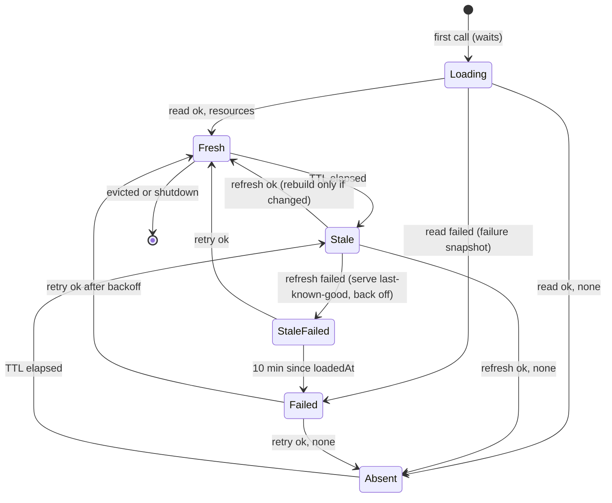

# Design

## Context

- Registered baseline: not parity-sensitive (see proposal). Platform references: grafana-app-sdk `v0.60.16` and `k8s.io/client-go v0.37.1`, both already in the Gateway's build list.
- `plugin.Run` builds the kubeconfig with `BuildKubeConfig` from `API_ACCESS_*` (falling back to a zero `rest.Config` with a warning), then calls the app provider once, before it serves anything. `Gateway.Provider()`'s callback receives it as `app.Config.KubeConfig` and passes it to `simple.NewApp`. Otherwise it's unused.
- With token exchange, the app-sdk transport exchanges on behalf of the caller when the request context carries `types.AuthInfo` or an ID token. Otherwise it exchanges as the plugin, with namespace `*`. The plugin v3 adapter puts the verified caller's `AuthInfo` on every route and admission context. `context.WithoutCancel` keeps that value.
- `extensionhost.Host` builds every enabled instance in `New` from the `Plan`. It precomputes `lists` per source and picks them in `Compose(selection)`, which has no context. The pipeline already reads request info from the invocation context (`RequestInfo(ctx)`, including `Namespace`). Close runs only at shutdown.
- `Plan` enables a tenant definition only when `EnabledByDefault` is set, with `{}`. `CheckConfig` compares a schema-less configuration with the literal `{}`.
- The generated `Middleware` type decodes `spec.config` into `map[string]interface{}`, which turns numbers into `float64`.
- app-sdk `v0.60.16` `simple.KindValidator.Validate` returns only `error`. The adapter doesn't expose the protocol's `warnings`.
- The protocol test host serves token exchange for access policies (`AddAccessPolicy`, `TokenExchangeHandler`) and get, create, update and delete for kinds, but not list.
- Go 1.27, so tests use `testing/synctest` (already used in the root module) for fake time.

## Goals / Non-Goals

**Goals:** apply each namespace's stored configuration without trusting callers; never fail open on read failures; bound memory, API load and staleness; give per-namespace instances a safe lifecycle; keep the shipped build inert until it registers a tenant extension.

**Non-Goals:** an all-namespace informer or watch; a status writer; operator-configurable cache constants; admission warnings through app-sdk (see Decision: admission without API access); shipped tenant extensions (#766); stack-catalog sources (#757).

## Decisions

### Reader and client construction

`tenantconfig.NewReader(kubeConfig rest.Config) (*Reader, error)`, called in the provider callback when `KubeConfig.Host` is not empty:

- Copies the config. Sets `GroupVersion` to the manifest group and `v1alpha1`, `APIPath` `/apis`, app-sdk's `k8s.GenericNegotiatedSerializer`, and an explicit client rate limit (`readQPS` 20, `readBurst` 40). Builds one `rest.RESTClientFor`. The kubeconfig's `WrapTransport` (token exchange) and TLS settings come along unchanged.
- `Read(ctx, namespace)` lists `namespaces/<ns>/middlewares` in pages of `listPageSize` (100), following `continue`. It streams each page through `io.LimitReader` with a total bound of `maxListBytes` (4 MiB) and decodes with `encoding/json` into a reader-local list type: `metadata.name`, `spec.type`, `spec.enabled *bool` and `spec.config json.RawMessage`. Raw JSON keeps numbers exact and doesn't depend on the generated codec.
- It returns `[]extensionhost.TenantResource{Name, Type, Enabled, Config}`, sorted by name, with `Config` compacted (`json.Compact` keeps number literals) and `{}` when absent or `null`.
- A failure returns a classed error: `refused` (401, 403), `not found` (404: the kind isn't served, never "no resources"), `unexpected status`, `timeout`, `invalid response` (decode error or exceeded bound) or `error`. Classification uses `apierrors` predicates and never keeps the body.
- Alternative: the generated `MiddlewareClient` through `k8s.NewClientRegistry`. Rejected because it decodes `config` into `float64`s. A dynamic or unstructured client converts numbers to `int64` or `float64`, which still loses precision outside `int64`.

`extensionhost` defines the interface it consumes, `TenantReader{ Read(ctx, namespace) ([]TenantResource, error) }`, so the cache tests use a fake reader. `tenantconfig` already imports `extensionhost` for `CheckConfig`.

### Handoff and API access

- `Gateway.Provider()`'s callback (the only kubeconfig consumer, owned by `gateway.Run`) decides `apiAccess := cfg.KubeConfig.Host != ""` once.
  - With access and at least one tenant definition, it builds the reader and calls `extensions.ConnectTenants(reader)`.
  - Without access and with tenant definitions, it logs one warning that tenant configuration isn't applied.
  - It builds the managed kinds there with `tenantconfig.NewValidator(definitions, apiAccess)`.
  - An idle Gateway builds no reader and its validators are never reached.
- `ConnectTenants` installs the cache once (an atomic pointer). Until then, and when it's never called, the host serves the startup lists, which are the no-API-access behavior. `plugin.Run` calls the provider before serving, so no request sees the gap.

### Detached loads

Loads run on a goroutine whose context is derived from the cache's own root (`context.Background()`, cancelled at `Close`), with `readTimeout` (5 s). No value from the call's context reaches the reader, so the token exchange always acts as the plugin. A caller waiting for a first load selects on its own context and the load's completion. Cancelling stops the wait, not the load.

### Cache state machine

One entry per namespace, in an LRU of `maxNamespaces` (1024). An entry holds the served snapshot, `loadedAt` (the last successful read), `retryAt`, and at most one in-flight load.

- **Acquire** (under the cache mutex):
  1. Touch the LRU.
  2. If the entry has no snapshot, start the load when none is in flight, then wait outside the lock.
  3. Otherwise:
     - if `now >= loadedAt+ttl` (or the last read failed), and no load is in flight, and `now >= retryAt`, start a background refresh;
     - if `loadedAt+maxStaleness <= now` and the snapshot is a read snapshot, replace it with the failure snapshot.
  4. Take a reference on the served snapshot and return it.
- **Load result:**
  - **Success:** compare the resources with the current snapshot's. If they're equal, only `loadedAt` moves. Otherwise build the new snapshot outside the lock, swap it in and retire the old one.
  - **Failure:** `retryAt = now + failureBackoff` (30 s, fixed). Without a snapshot, install the failure snapshot. Otherwise keep last-known-good until the bound.
  - **Evicted meanwhile:** a result for an evicted entry is retired at once.
- **Constants:** `ttl` 1 minute, `maxStaleness` 10 minutes, `readTimeout` 5 s, `failureBackoff` 30 s and `maxNamespaces` 1024 are named constants that `extensionhost.TenantCacheConfig` can override in tests. The clock comes from `Config.Clock`, so `synctest` drives it.
- **Revision:** a per-entry counter that increments on every swap. It appears in logs. The list key is the snapshot itself, keyed by source inside it, so the effective key is (namespace, revision, source), and ownership follows from the source.
- **Memory:** a snapshot keeps no raw configuration beyond what instances retain. Equality uses a SHA-256 of the normalized resources. The worst case is `maxNamespaces` × tenant definitions × 64 KiB of configuration retained by instances.

### Snapshots

A snapshot is built from the resources and the tenant definitions. For each tenant definition:

| Resource | Result |
|---|---|
| none | default: the startup instance when enabled by default, else off |
| `enabled: false` | off |
| `enabled: true`, `CheckConfig` passes, `New` succeeds with a phase | its own instance |
| invalid config, missing `enabled`, `name != type`, factory error, panic or no phase | failed: `skip` drops it; `fail-closed` marks it unavailable |

- The **failure snapshot** marks every tenant definition failed, and builds nothing.
- Enabled resources whose name isn't a tenant definition are unknown. They're logged and counted once per entry and type (the entry keeps a set), and disabled ones are ignored.
- Configuration and factory failures count once per build under `extension_events_total{phase="configure",event="failed"}`, with one warning naming the extension, namespace, policy and class. Calls that a `fail-closed` failure refuses are visible in the model metrics as unavailable errors.
- Each snapshot precomputes `lists` per source with the existing `listsFor` logic over operator instances, default tenant instances and its own instances. It also keeps the unavailable definitions that apply to each source. An absent snapshot reuses the startup lists.

### How the pipeline consumes it

- `New` builds the operator and default-tenant instances as today, plus `tenantSources[source]`: whether any tenant definition applies to that source.
- `Compose` returns the model unchanged only when neither an instance nor a tenant definition applies to the source. Otherwise it returns the pipeline, as before.
- `pipeline.newCall(ctx)`:
  - When the cache is connected and `tenantSources[source]` is true, it acquires the namespace's snapshot and uses `snapshot.lists[source]`. Otherwise it uses the startup lists, so no read happens.
  - When the lists carry an unavailable definition, the call ends with `ErrUnavailable` before admit, with an observe record of outcome error, as a fail-closed admit failure does.
- Release:
  - after `DoGenerate` returns when the lists don't check output;
  - after request phases for a stream that returns the model's stream directly;
  - otherwise when the call's observation finishes (or is dropped).

The composer signature, `execution`, and #757's selection seam are unchanged. #763 already moved request facts to invocation.

### Instance lifecycle

- Built once per namespace revision, on the load goroutine. Unchanged refreshes run no factory.
- **Reference counting:** acquire happens under the cache mutex, and retire happens under the same mutex. So a snapshot that a call has acquired is never closed before the call releases it.
- **Retire** (replacement, eviction, expiry, or a result for an evicted entry) marks the snapshot. The last release, or the retire itself when there are no references, closes its own instances once, on a goroutine. Each close is bounded by `closeTimeout` (1 s), contained, and counted on failure as phase `close`. Startup instances are never closed on retire.
- **`Host.Close`** cancels the cache root and closes observations as today. It then closes operator, default-tenant and every live or retiring snapshot's instances under the shared final-flush budget, waiting for closes already started.

### Collectors shared per definition

- `New` builds one `sharedRegisterer` per definition, wrapping `prometheus.WrapRegistererWith({extension: name}, registerer)`, and gives it to every instance of that definition.
- `Register` treats `AlreadyRegisteredError` whose `ExistingCollector` is the same collector value as success. It compares only when the dynamic type is comparable. A different collector with the same descriptors still fails, so that factory run fails and applies the failure policy.
- The godoc on `Dependencies.Registerer` and `Definition.New` states the contract: create collectors once per definition, register them in `New`, and never unregister them in `Close`.
- Alternatives:
  - A definition-level setup hook: rejected for now, because it adds public API that no current extension needs, and the shared registerer covers it.
  - Swallowing every `AlreadyRegisteredError`: rejected, because the new collector would silently never be gathered.

### Decision: admission without API access

app-sdk `v0.60.16` validators can't return warnings.

| Option | Pros | Cons |
|---|---|---|
| A. app-sdk change: an optional warning-returning validator, passed to the protocol's `warnings` | Matches the issue | Cross-repo change and release, plus Grafana must surface plugin warnings. Can't be proven here, and blocks this issue |
| **B. Refuse `CREATE`/`UPDATE` with `400` and a fixed reason (recommended)** | Loud and deterministic, testable now through the test host. An admin can't store configuration that silently does nothing. Existing installs have no resources, because the kind is new | Deviates from "resources are accepted" in the design article. Admins can't stage configuration before enabling API access |
| C. No admission signal, only docs and a startup log | No code | Admins see a successful write that has no effect |

**B** runs before every other check, including the disable-only path: with no API access no stored state applies, so refusing loses nothing, and deletes stay unreviewed. The reason names neither toggles nor values: "middleware: this Gateway cannot read Middleware resources on this host, so stored configuration would not be applied". A follow-up issue can switch to a warning (A) once app-sdk exposes one.

### Test host

Add list (`GET .../namespaces/<ns>/<plural>`) to `test/platformhost`. It returns a `<Kind>List` of that namespace's objects in name order, with no pagination, behind the existing namespace check. Host behavior stays out of platform evidence.

### Development deployment check (manual)

The shipped build registers no tenant extension, so it makes no reads, and no CI or local run here can show Grafana or Cloud behavior. Go and CI show:

- **Go, test host:** the reader lists two namespaces over HTTP with a real app-sdk token-exchange kubeconfig. Every exchange carries no subject token, even when the triggering call carried a user's token. 403, 404, 5xx, a timeout, an oversized body and malformed JSON are failures, and an empty list is absence.
- **Go, gateway:** with test definitions, resources created through admission in two namespaces apply to their own language-model calls. With a zero kubeconfig, defaults run, nothing is read and creates are refused.
- **CI end-to-end, if open question 4 is approved:** the pinned Grafana gives the plugin API access.

Manual follow-up for nara, on the first build that registers a tenant extension (#766) in a development wave:

1. Create a `Middleware` in two stack namespaces with different configurations.
2. Call each stack's language-model route.
3. Confirm each applies its own configuration.
4. Confirm the plugin logs show no `refused` read failures, and `grafana_ai_gateway_tenant_config_reads_total{result="success"}` grows.

This verifies `list` on `middlewares` for the plugin identity and the wildcard-namespace token exchange.

## Test plan

All cache, snapshot and pipeline timing tests run in `synctest` bubbles with fake readers that block on channels. They use `synctest.Wait` for background refreshes, with no sleeps or polling. HTTP tests run outside bubbles and use no timing.

| Acceptance | Evidence |
|---|---|
| Two namespaces stay isolated | `extensionhost` pipeline test: a recording tenant transform configured differently in `a` and `b`, defaults in `c`, and disabled default-on in `d`, unary and stream. Gateway test through the test host: resources created via admission in two namespaces, with each call's transform reflecting its own configuration. |
| A read failure never applies a more permissive default; last-known-good stays within the bound | Cache test: first read fails, so `skip` default-on is off and `fail-closed` refuses with `ErrUnavailable` and zero model calls. Success, then failing refreshes: at `loadedAt+10m-1ns` last-known-good still disables a default-on extension, and at `+10m` the failure policy applies. Then success restores. Reader tests: 403 and 404 are failures, not absence. |
| An unknown type is skipped and counted | Snapshot test: an enabled unknown resource, three acquires and two unchanged refreshes produce one log and one count. A disabled unknown produces neither. An operator-type name is unknown too. |
| Caller permissions don't affect reads | Cache test: the reader's context carries no `AuthInfo` and isn't cancelled when the waiting caller cancels, and the next call uses the result without a second read. Gateway test: the test host's exchange log shows no subject token for reads triggered by a user's call. |
| Concurrent first requests share one load | Cache test: ten goroutines acquire an uncached namespace, `synctest.Wait`, one `Read` call, and after release all hold the same snapshot. |
| A change applies within the TTL (injected) | Pipeline test: a call at `ttl-1ns` sees the old configuration and doesn't read. A call at `ttl` sees the old configuration and triggers one refresh. After `synctest.Wait`, the next call sees the new one. A refresh that fails is retried at `retryAt` and not before. |
| Self-hosted without API access | Gateway test with a zero kubeconfig: no list request reaches the test host, default-on runs, default-off doesn't, one warning record, a create refused with `400` and the fixed reason, and a delete succeeds unreviewed. `tenantconfig` validator test: the no-access refusal precedes the disable-only path. |
| Development deployment check | Manual follow-up (above). |
| Follow-ups: raw JSON, read-time check | Reader test: `9007199254740993` and `1.0` reach the factory as written. Snapshot test: a schema-less extension with stored `{ }` from a non-compacting server passes. A tightened schema applies the failure policy, with a sentinel absent from logs. |
| Follow-ups: collectors, close | Two namespaces register one shared counter and gather shows one series. A fresh collector on each run fails the second namespace. Replacement during an open stream closes the old instance once, after the stream and its observation end. Eviction with `maxNamespaces` 1 closes after release. Shutdown closes snapshot instances within the budget. Run under `-race`. |
| No reads when nothing needs them | Pipeline test: an operator-only extension, and a tenant extension declaring `operator` on a BYOK call, make zero `Read` calls. Gateway test: the shipped definitions make no list request. |

## Risks / Trade-offs

- [A fail-closed tenant extension turns an API outage into refused calls for every namespace where it applies, even without resources] → It's the approved "never more permissive" rule. The guide says tenant gates should prefer `skip`, and must-have gates are mandatory operator extensions. #766's extensions are `skip`.
- [First calls in a namespace wait for a read, up to 5 s] → Only the first call per entry. Refreshes are background. Absence is cached too.
- [API load is replicas × active namespaces / TTL, and deploy restarts cause a cold-start burst] → Client rate limit and the backoff. Documented. An informer is the later investigation.
- [Wildcard-namespace plugin token and `list` permission are unverified in Cloud] → Manual deployment check. The read-failure class `refused` makes a gap visible.
- [Refusing writes without API access deviates from the design article's "accepted with a warning"] → Recorded decision B and the follow-up to A.
- [Unknown-type logs repeat after eviction] → Bounded by eviction rate. Documented.
- [Factories run on the load goroutine without a context] → Documented: factories must be quick and must not do I/O. A slow factory delays only that namespace's first load.
- **#766 risks:**
  - Its end-to-end suite makes the first real reads against Grafana. If the pinned nightly gives the plugin no API access, decision B refuses its creates. Open question 4 detects this in this change.
  - Disabling and re-enabling takes up to one TTL per change against Grafana, so its end-to-end checks need a bounded poll, about 70 s, or an injected TTL that the shipped `dist/` can't carry.
  - `default-settings` must keep the factory free of collectors, or use the shared-registerer idiom.
  - The org admin guide must cover propagation, roles and the no-API-access refusal.

## Migration Plan

- No data migration. The shipped build registers no tenant extension, so behavior and API traffic are unchanged until #766.
- Rolling back restores the earlier behavior: stored resources are ignored, and default-on tenant extensions run everywhere.
- Rolling forward to a build that drops a tenant extension leaves its resources counted as unknown when enabled.

## Open Questions

1. **Admission without API access:** B (refuse with 400) or A (app-sdk warning) or C (docs only). Recommendation: **B**, with a follow-up issue for A.
2. **Disabled unknown types:** excluded from the unknown-type log and count. Recommendation: **exclude**, since they have no effect.
3. **Constants:** TTL 1 min, staleness 10 min, read timeout 5 s, backoff 30 s fixed, LRU 1024 namespaces, client limit 20 QPS with burst 40, list bound 4 MiB in pages of 100. Recommendation: **accept**, and revisit LRU size and TTL with development metrics.
4. **API-access evidence in CI:** add one Info record at app construction stating whether the plugin has API access, regardless of tenant definitions. Add an `e2e.sh` positive check that it reports access on the pinned image. This also closes #764's follow-up on the vacuous plugin-log sentinel check. Recommendation: **yes**.
5. **Cache constants as operator settings:** recommendation: **no**. They stay constants, and #766 polls.
